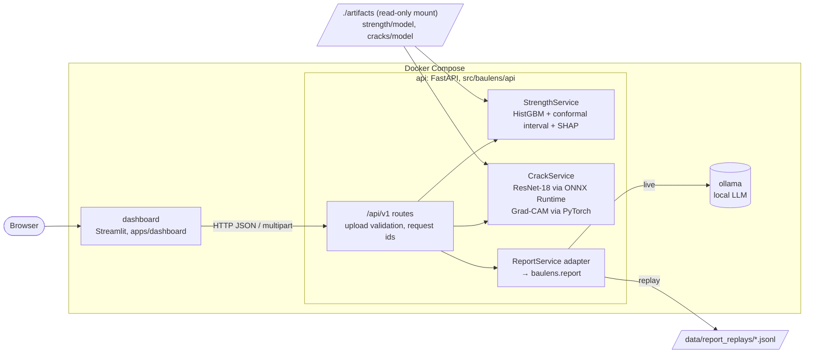

# Architecture

BauLens has three analysis modules behind one HTTP API and a dashboard that only talks to
that API. Shared Pydantic contracts in [`src/baulens/schemas.py`](../src/baulens/schemas.py)
are the only interface between the modules.



- **Artifacts.** Each model directory holds immutable generations behind a `current.json`
  pointer ([`src/baulens/artifacts.py`](../src/baulens/artifacts.py)). The API resolves the
  pointer once at startup and verifies every file against the generation manifest. Weights
  are produced by `make strength` and `make cracks` and are not in git.
- **Startup.** Models load once in the FastAPI lifespan. A missing or tampered model makes
  only its component unavailable: the matching endpoints answer 503 and `GET /health`
  reports the reason and the versions of everything that did load.
- **Requests.** Inference runs in the threadpool. Each request gets an `X-Request-ID` that
  appears in the response, in error bodies and in the JSON access log (method, path,
  status, duration; no bodies or file names).
- **Dashboard.** Streamlit reads `BAULENS_API_URL` and calls the API with `httpx`. It does
  not import model code, so its image contains no PyTorch.
- **Modes.** `BAULENS_LLM_MODE=live` lets the API call Ollama. `replay`, used by the demo
  Compose override, refuses live requests with 403 and serves recorded output only.

## Endpoints

| Method and path | Body | Response |
| --- | --- | --- |
| `GET /api/v1/health` | – | readiness and model version per component, LLM mode |
| `GET /api/v1/models` | – | versions, test metrics, training-domain ranges |
| `POST /api/v1/strength/predict` | `ConcreteMix` | `StrengthPrediction` |
| `POST /api/v1/cracks/predict?gradcam=true` | multipart `file` (JPEG/PNG ≤ 10 MB) | `CrackPrediction`, `ImageMetadata`; with `gradcam=true` an upright preview and a Grad-CAM overlay of the same size |
| `POST /api/v1/report` | `InspectionInput`, `source` (`live`/`replay`/`template`) | report envelope with checks |
| `GET /api/v1/report/cases` | – | recorded cases that `replay` can serve |

The interactive OpenAPI documentation is served at `/api/v1/docs`.

Uploaded images must be JPEG or PNG, and the declared type must match the content. The pixel
count is checked from the header before any decoding. Images reach the model as upright
8-bit RGB: 16-bit greyscale is scaled linearly to 8 bit, transparency (alpha or a palette
transparency entry) is composited on white, and other modes are rejected with 415. The full
contract is in [`uploads.py`](../src/baulens/api/uploads.py). Error responses never contain
artifact paths or exception text; the cause is logged server-side under the request id.

## Report flow

The report endpoint answers 503 until the report module (Milestone 4) is wired into
[`report_service.py`](../src/baulens/api/report_service.py). The intended flow:

```mermaid
sequenceDiagram
    actor U as User
    participant D as Dashboard
    participant A as API
    participant R as ReportService
    participant L as Ollama or replay file

    U->>D: run strength and crack analyses
    D->>A: POST /strength/predict, POST /cracks/predict
    A-->>D: StrengthPrediction, CrackPrediction + ImageMetadata
    U->>D: choose source, "Bericht erstellen"
    D->>A: POST /report {case: InspectionInput, source}
    alt source = live and BAULENS_LLM_MODE = replay
        A-->>D: 403 live generation disabled
    else
        A->>R: generate(request) in threadpool
        opt source = live or replay
            R->>L: draft request (slots mode)
            L-->>R: JSON draft
        end
        R->>R: numeric faithfulness check
        Note over R: a draft with an unsupported number is never delivered;<br/>the deterministic template is returned instead
        R-->>A: ReportResponse (status, source, checks, latency)
        A-->>D: 200 ReportResponse
        D-->>U: German draft, verified numbers highlighted,<br/>replays labelled "Aufgezeichnete Ausgabe"
    end
```

Replays are keyed by the full input, so `replay` only serves the recorded cases listed by
`GET /report/cases`; the dashboard offers those instead of the user's own results.

See [ADR 0005](adr/0005-api-and-dashboard.md) for the reasons behind these choices.
