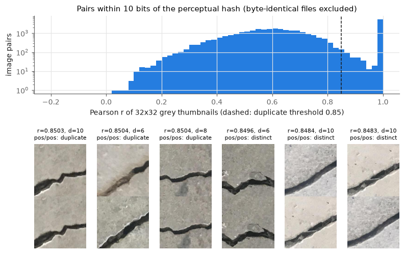
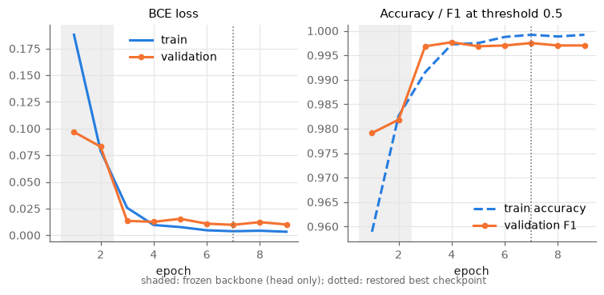
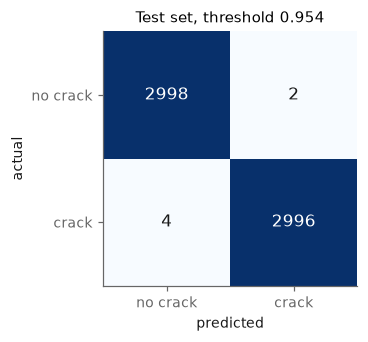
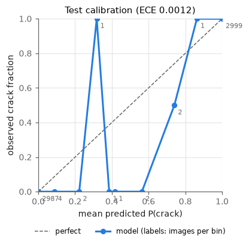
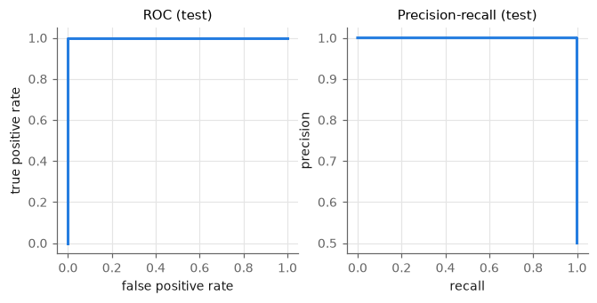
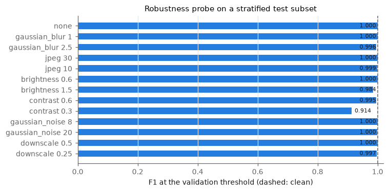

# Crack detection: results

Binary classification of 227 × 227 px concrete surface patches (crack / no crack) on the
[Özgenel (2019)](https://data.mendeley.com/datasets/5y9wdsg2zt/2) dataset (CC BY 4.0) with
ResNet18 transfer learning on a laptop CPU. Model card: [docs/model_cards/cracks.md](../model_cards/cracks.md).

**Summary.** On the held-out test split (6,000 images, duplicates grouped), the model makes 6
errors: F1 0.9990 (95 % CI 0.9981–0.9997), ROC-AUC 0.999997. **Treat this as near-ceiling
performance on a homogeneous single-source dataset, not as evidence of field readiness.** The
numbers that are informative here are elsewhere. A third of the dataset is duplicated, which
would have leaked into a naive split. Low contrast and over-exposure cut recall noticeably. The
few errors show hairline cracks and probable label noise.

Reproduce with `make cracks`, or with `uv run baulens cracks split|train|evaluate|export|benchmark`
and the default [configs/cracks.yaml](../../configs/cracks.yaml) (seed 42). Raw outputs land in
`artifacts/cracks/`; the figures below are written to `docs/figures/cracks/` by the same run.

## 1. Data, split and leakage check

| | Negative | Positive |
| --- | ---: | ---: |
| Images (all 227 × 227 RGB JPEG) | 20,000 | 20,000 |
| Mean RGB | 186 / 181 / 173 | 168 / 163 / 155 |
| Mean within-image grey std | 8.7 | 30.6 |
| Byte-identical files (members of a duplicate set) | 2,513 | 604 |

The classes are perfectly balanced. Cracked patches are darker on average and have about 3.5 ×
the pixel contrast of intact ones, so simple intensity statistics already separate the classes
to a large extent. That is one reason the task is easy.

**Why a leakage check.** The 40,000 patches were cropped from 458 photos, and the photo IDs are
not published, so a random split can put copies or neighbours of the same view into train and
test. The check (`baulens.cracks.splits`) works in three steps:

1. SHA-256 of every file finds byte-identical copies.
2. A 64-bit DCT perceptual hash of a 32 × 32 grey thumbnail is computed for every image. All pairs
   within Hamming distance 10 are found exhaustively (8 × 10⁸ comparisons, about 15 s).
3. Hash candidates are **confirmed** when the Pearson correlation of their thumbnails is
   r ≥ 0.85. The hash alone is not specific on crack patches: two different cracks with a
   similar course share most low-frequency bits. At distance ≤ 10 there are 33,156 hash pairs,
   94 of them with *different* labels, and inspection showed that most are different images.
   The r ≥ 0.85 cut-off was set by looking at sample pairs from each correlation band, before
   any model was trained. Above r ≈ 0.95 every pair was a copy; 0.85–0.95 was mixed; below
   0.85 the pairs were mostly distinct.

Confirmed pairs are joined into connected components (groups), and every group goes into one
split. Within each class the groups are shuffled with the seed and filled into test, validation
and train in order. This gives exactly 70 / 15 / 15 % per class: 14,000 / 3,000 / 3,000 images
of each class.

| Duplicate kind | Pairs | Images involved | Label conflicts | Cross-split pairs, naive split | Cross-split pairs, grouped split |
| --- | ---: | ---: | ---: | ---: | ---: |
| Byte-identical | 1,681 | 3,117 | 0 | 763 | **0** |
| Confirmed (identical or r ≥ 0.85) | 7,293 | 12,920 | 0 | 3,328 | **0** |

**12,920 images (32 %) belong to 6,194 duplicate groups** (largest group: 25 images). A plain
stratified random split with the same seed would have put 3,328 duplicate pairs across split
boundaries. The test set would then partly contain images the model had already seen.

*Top: correlation of all non-identical pairs within 10 hash bits; the spike at r ≈ 1 consists of
re-encoded copies. Bottom: the three accepted pairs with the lowest r, then the three rejected
pairs with the highest r.*

**Limits of this check, stated honestly.**

- The borderline examples show that some pairs *just below* the threshold are visibly different
  views of the same crack (shifted crop, different exposure). Lowering the cut-off to r ≥ 0.80
  would group 546 more pairs. 238 of those cross our splits, and an unknown share of them are
  real same-crack views. Residual near-duplicate leakage therefore remains, but it is small
  relative to what was removed.
- Distinct, non-overlapping patches of the same photo cannot be detected at all. They share
  camera, lighting and surface, so the test set is **not** independent of the training photos.
- Rotated or mirrored copies are not searched for. The dataset description states that no
  rotation or flip augmentation was applied.

## 2. Training

| Setting | Value |
| --- | --- |
| Backbone | ResNet18, `ResNet18_Weights.IMAGENET1K_V1` (11.2 M parameters), new 1-logit head |
| Input | 128 × 128 px (patch resized, not cropped), ImageNet mean/std |
| Training images | stratified 40 % of the train split = 11,200 (CPU budget); validation 6,000 |
| Phase 1 | 2 epochs, backbone frozen, head only, AdamW lr 1e-3, cosine decay per step |
| Phase 2 | up to 8 epochs, `layer4` + head unfrozen, AdamW lr 2e-4, cosine; frozen BatchNorm layers stay in eval mode |
| Regularisation | weight decay 1e-4; early stopping on validation BCE loss, patience 2, best checkpoint restored |
| Augmentation | random resized crop (scale 0.6–1, aspect 0.8–1.25), horizontal and vertical flips, random 90° rotations, colour jitter (brightness and contrast ±0.2, saturation ±0.1, hue ±0.02) |
| Batch / threads / workers | 64 / 6 PyTorch threads / 2 loader workers |
| Hardware | AMD Ryzen 7 5700U (8 cores), CPU only, shared with two other CPU-heavy jobs |
| Wall-clock | **46 min** for 9 epochs (178–475 s per epoch depending on the other jobs) |

Why these augmentations: patches have no canonical orientation, so flips and 90° rotations do not
change the label. Crops vary scale and position slightly, the way camera distance varies.
Brightness and contrast jitter imitate lighting changes. Saturation and hue stay small because
concrete is nearly grey and colour is not a crack cue. Elastic or perspective warps were left
out, since they can create or erase crack-like structures.

Early stopping ended training after epoch 9 and restored **epoch 7** (validation loss 0.0098,
validation F1 at 0.5: 0.9975). Fine-tuning `layer4` brought the main gain: validation loss
dropped from 0.083 to 0.013 in the first fine-tuning epoch. An interrupted earlier run with the same seed had
produced identical losses for epochs 1–6, so training is reproducible on CPU.

## 3. Threshold (validation only) and test metrics

The decision threshold maximises F1 on the **validation** split over a 0.001 grid. Ties go to the
threshold nearest 0.5, which avoids picking a value at the edge of a flat optimum. F1 rather
than Youden's J is used because the classes are balanced and F1 focuses on the crack class; on
validation both choose the same threshold. The chosen threshold, **0.954**, is high: on
validation it removes 9 false positives and adds 2 false negatives compared with 0.5. It was
then applied **once** to the test split.

| Split (6,000 images each) | Precision | Recall | F1 | Accuracy | ROC-AUC | PR-AUC | ECE |
| --- | --- | --- | --- | --- | --- | --- | --- |
| Validation | 0.9987 | 0.9987 | 0.9987 | 0.9987 | 0.99998 | 0.99998 | 0.0028 |
| **Test** | **0.9993** | **0.9987** | **0.9990** | **0.9990** | **0.999997** | **0.999997** | **0.0012** |
| Test, 95 % bootstrap CI | 0.9983–1.0000 | 0.9973–0.9997 | 0.9981–0.9997 | 0.9982–0.9997 | 0.99999–1.0 | 0.99999–1.0 | |

The confidence intervals are percentile bootstraps over test images (2,000 resamples, threshold
fixed). Test confusion matrix: TN 2,998, FP 2, FN 4, TP 2,996. For transparency only (it was not
used): at threshold 0.5 the test split would have had FP 5 and FN 1, with the same F1. Given the
CIs, the two thresholds cannot be distinguished on this data.

|  |  |
| --- | --- |

**Calibration.** ECE is 0.0012 on test with 15 equal-width bins. The model is extremely
confident: 99.8 % of test images get P < 1/15 or P > 14/15. The middle bins of the reliability
diagram contain only 1–4 images each, so the curve there is noise, and the small ECE mostly
reflects how few images fall into those bins. It does not show that intermediate probabilities
are meaningful. Under the corruptions below, the model loses recall while its precision stays at
1.0. In other words, confidence does not drop as image quality drops, which is the more relevant
calibration finding.

**Why near-ceiling, and what that does not show.** The dataset is homogeneous: one campus, similar
cameras and lighting, patches chosen to contain either a clear crack or plain surface, with few
hard negatives such as joints, edges, formwork marks or shadows. The classes also differ strongly
in simple contrast statistics, and test shares source photos with train. The scores therefore
show that the pipeline works and that ResNet18 features transfer well. They do **not** show
generalisation to other structures, materials, cameras, distances or lighting. They also do not
show performance at deployment prevalence, where cracks are rare and precision would fall.

## 4. Robustness probe (synthetic corruptions)

A cheap stand-in for domain shift: corruptions applied to the original 227 px test patches of a
stratified 2,000-image test subset, before the usual preprocessing, with the validation threshold
fixed (`baulens.cracks.robustness`). On this subset the clean model makes no errors (F1 1.000).

| Corruption | Level | Accuracy | Precision | Recall | F1 | Δ F1 | Δ recall |
| --- | --- | ---: | ---: | ---: | ---: | ---: | ---: |
| none | – | 1.0000 | 1.000 | 1.000 | 1.0000 | – | – |
| Gaussian blur | radius 1 px | 1.0000 | 1.000 | 1.000 | 1.0000 | 0.000 | 0.000 |
| Gaussian blur | radius 2.5 px | 0.9955 | 1.000 | 0.991 | 0.9955 | −0.005 | −0.009 |
| JPEG | quality 30 | 1.0000 | 1.000 | 1.000 | 1.0000 | 0.000 | 0.000 |
| JPEG | quality 10 | 0.9990 | 0.999 | 0.999 | 0.9990 | −0.001 | −0.001 |
| Brightness | × 0.6 | 1.0000 | 1.000 | 1.000 | 1.0000 | 0.000 | 0.000 |
| Brightness | × 1.5 | 0.9845 | 1.000 | 0.969 | 0.9843 | −0.016 | −0.031 |
| Contrast | × 0.6 | 0.9945 | 1.000 | 0.989 | 0.9945 | −0.006 | −0.011 |
| **Contrast** | **× 0.3** | **0.9205** | **1.000** | **0.841** | **0.9136** | **−0.086** | **−0.159** |
| Gaussian noise | σ = 8 | 1.0000 | 1.000 | 1.000 | 1.0000 | 0.000 | 0.000 |
| Gaussian noise | σ = 20 | 0.9995 | 1.000 | 0.999 | 0.9995 | −0.001 | −0.001 |
| Downscale | × 0.5 and back | 1.0000 | 1.000 | 1.000 | 1.0000 | 0.000 | 0.000 |
| Downscale | × 0.25 and back | 0.9965 | 1.000 | 0.993 | 0.9965 | −0.004 | −0.007 |

Every corruption that hurts reduces **recall**, while precision stays at 1.0. Strong low contrast
(× 0.3) misses 16 % of cracks, and over-exposure (× 1.5) misses 3 %. ROC-AUC stays at 1.000 in
every row, so the ranking survives and the probabilities shift down below the high threshold
0.954. This fits the observation in section 1 that the model relies heavily on local contrast.
For field use, flat lighting, haze, dust or overexposed photos are therefore the main risk, and
the threshold would need to be re-chosen on representative images.

These corruptions are not a second dataset. The obvious next test is a cross-dataset evaluation
on **SDNET2018** (Dorafshan et al., CC BY 4.0: bridge decks, walls and pavements with shadows,
stains and finer cracks), which this milestone does not implement.

## 5. Explainability: Grad-CAM and error gallery

Grad-CAM is implemented with forward and backward hooks on `layer4` (`baulens.cracks.gradcam`).
It weights the 512 activation maps by their spatially averaged gradient of the crack logit,
applies ReLU, upsamples bilinearly and scales each image to [0, 1]. At 128 px input, `layer4` has
only 4 × 4 cells, so the maps show *where roughly*, not the crack outline. Maps without positive
evidence are left at zero rather than stretched.

On random true positives the heat sits on the crack, mostly where it is widest or branches. True
negatives get no positive crack evidence at all (flat maps).

All 6 test errors are shown. Qualitative reading:

- **False positive `Negative/07903.jpg` (P = 0.995).** A thin dark line runs across the patch, and
  the map focuses on it. To the eye this is a hairline crack, so it is likely a **labelling error**
  in the dataset rather than a model error.
- **False positive `Negative/10675.jpg` (P = 0.995).** A dark stain or spall edge with a sharp
  boundary. This is a typical hard negative: a crack-like edge that is not a crack. Field images
  contain many more of these than this dataset does.
- **False negatives `18342_1.jpg` (0.32), `09306.jpg` (0.75), `01360.jpg` (0.86).** Very thin,
  short or low-contrast hairline cracks. The map finds the right spot, but the
  evidence is weak.
- **False negative `00148.jpg` (0.94).** A clearly visible crack that scores just below the high
  threshold of 0.954; at 0.5 it would be detected. In a screening setting, a recall-oriented
  threshold would be the better choice (see the model card).

## 6. ONNX export and parity

`baulens cracks export` exports the model with the torch.export-based exporter (opset 18) and a
dynamic batch axis. Outputs are `logit` and `probability`, each of shape (N,). The graph passes
`onnx.checker.check_model(full_check=True)`, and the export compares PyTorch and ONNX Runtime
(CPU EP) on 512 stratified test images, at batch 512 and batch 1.

| Check | Result |
| --- | --- |
| Max \|Δ logit\| | 3.8 × 10⁻⁵ (tolerance 1 × 10⁻⁴) |
| Max \|Δ probability\| | 1.2 × 10⁻⁷ |
| Identical labels at threshold 0.954 | yes (512 / 512) |
| ONNX file / state dict | 44.8 MB / 44.8 MB (float32) |

## 7. CPU inference benchmark

`baulens cracks benchmark` runs each backend in a fresh subprocess, with 10 warm-up and 100 timed
iterations on preprocessed 128 px input. It ran on the AMD Ryzen 7 5700U (8 cores / 16 threads)
with 6 intra-op threads. Other CPU jobs were running on the machine (system CPU 18 % in the second
before the run), so treat the absolute numbers as indicative.

| Backend | Batch | Median latency | p95 latency | Throughput | Load time | Peak RSS |
| --- | ---: | ---: | ---: | ---: | ---: | ---: |
| PyTorch eager | 1 | 15.7 ms | 39.3 ms | 64 img/s | 0.44 s | 500 MB |
| PyTorch eager | 32 | 233 ms | 284 ms | 137 img/s | | |
| **ONNX Runtime** | **1** | **5.0 ms** | **5.6 ms** | **199 img/s** | **0.11 s** | 514 MB |
| ONNX Runtime | 32 | 120 ms | 128 ms | 266 img/s | | |

ONNX Runtime is about 3 × faster at batch 1 and has a much tighter tail. End to end through the
inference API (JPEG already decoded), `CrackClassifier.predict` takes about 6 ms. A Grad-CAM map
takes about 50 ms, plus about 0.25 s once to load the PyTorch checkpoint. Peak RSS covers the
whole Python process, including the imported libraries.

## 8. Limitations and open points

- One dataset from one site, at patch level. No localisation beyond a coarse 4 × 4 Grad-CAM map,
  and no crack width, length or type.
- Test images share source photos with training images (not detectable), and some near-duplicates
  below the r ≥ 0.85 cut-off remain. The test score is optimistic.
- The CPU default uses 40 % of the training split at 128 px. `configs/cracks_full.yaml` (all
  28,000 training images, 224 px, two fine-tuned stages, up to 15 epochs, `device: auto`, which
  also covers ROCm) is prepared for a GPU machine but **not run**. With accuracy already at
  0.999, the larger run would mostly matter for robustness and finer Grad-CAM maps.
- Only one seed was trained. Variation between seeds is unmeasured, and with 6 test errors it
  would be dominated by individual images.
- The threshold maximises F1. A screening deployment should set it to meet a recall target on
  representative data.
- EfficientNet-B0 is implemented (`architecture: efficientnet_b0`) but was not trained here.
- Provenance: `metadata.json` of this run records `git_sha` 93e814a with `git_dirty: true`,
  because the SHA was read at the end of training. The training ran on source identical to
  672c34c; the two later commits only touched tests. `train()` now records the revision at the
  start of training.
