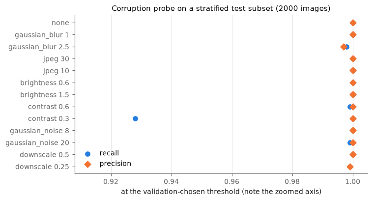
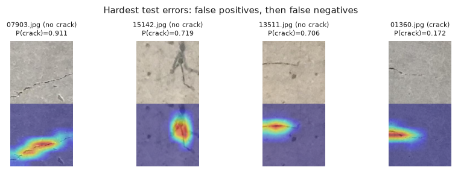
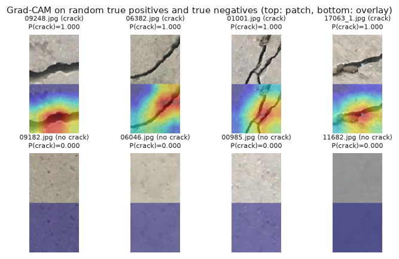
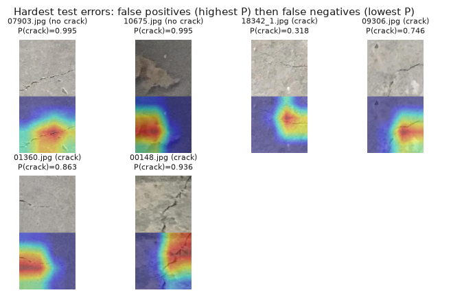

# Crack detection: results

Binary classification of 227 × 227 px concrete surface patches (crack / no crack) on the
[Özgenel (2019)](https://data.mendeley.com/datasets/5y9wdsg2zt/2) dataset (CC BY 4.0).
See the [model card](../model_cards/cracks.md).

## Desktop comparison

The M3 column preserves the original laptop run from M3. The two full-resolution models used
the same 28,000 training patches, seed 42, 224 px input, ImageNet initialisation, batch size 64,
two head-only epochs and up to 15 fine-tuning epochs with the last two backbone blocks trainable.
Early stopping restored the lowest validation BCE loss. The evaluator chose the F1 threshold on
6,000 validation patches before scoring the 6,000 held-out test patches. Group bootstrap CIs use
2,000 resamples and a fixed threshold. The corruption probe uses a stratified 2,000-patch subset,
matching M3. The full config now sets six CPU threads for the benchmark and uses epoch checkpoints.

All three desktop runs have the same data checksum
`8e21abdf960107a79add158f07e93b6c24b8de77a06d97ae57bd11d66a84092a` and split checksum
`6d069c45af6140d0cb2f5bcc199bd5e6ccad0f089b6b5d017fad50801299735a`. The split uses the M3 recipe and
reproduces its class counts and duplicate report. The M3 laptop model metadata records both
identical checksums, confirming that the split reproduced exactly across machines.

| Metric | M3 laptop ResNet18 | Full ResNet18 | EfficientNet-B0 |
| --- | --- | --- | --- |
| Train patches / input | 11,200 / 128 px | 28,000 / 224 px | 28,000 / 224 px |
| Validation threshold | 0.954 | 0.909 | 0.600 |
| Test F1 [95% group CI] | 0.9990 [0.9982, 0.9997] | 0.9990 [0.9979, 0.9998] | 0.9993 [0.9987, 0.9998] |
| Test ROC-AUC | 0.999997 | 0.999996 | 0.999999 |
| Test ECE | 0.0012 | 0.000874 | 0.000887 |
| Test FP / FN | 2 / 4 | 3 / 3 | 3 / 1 |
| Contrast 0.6x F1 / recall | 0.9945 / 0.989 | 0.9899 / 0.980 | 0.9995 / 0.999 |
| Contrast 0.3x F1 / recall | 0.9136 / 0.841 | 0.8256 / 0.703 | 0.9627 / 0.928 |
| Brightness 1.5x recall | 0.969 | 0.996 | 1.000 |
| ONNX max abs. logit / probability error | 3.8e-5 / 1.2e-7 | 2.29e-5 / 1.19e-7 | 8.96e-5 / 9.54e-7 |
| Recorded training time | 46 min | 8 min 53 s | 14 min 41 s |
| Epochs run / restored | 9 / 7 | 10 / 7 | 12 / 9 |
| Training hardware | Ryzen 7 5700U CPU (shared load) | Radeon RX 6800, Ryzen 7 9800X3D | Radeon RX 6800, Ryzen 7 9800X3D |
| CPU batch 1 median, ORT / PyTorch (laptop for M3) | 6.3 / 20.0 ms | 4.10 / 5.25 ms | 1.89 / 7.45 ms |
| CPU batch 32 median, ORT / PyTorch (laptop for M3) | 174 / 351 ms | 126.78 / 197.15 ms | 78.78 / 162.78 ms |

The ONNX graphs passed the checker and agreed with PyTorch on all 512 parity labels. The
EfficientNet-B0 graph is 15.9 MiB, compared with 42.7 MiB for both ResNet18 graphs.
EfficientNet-B0 resumed from epoch 3 after a native HIP abort. Its 14 min 41 s is the recorded
training time across both GPU processes, excluding work lost after the last checkpoint and
downtime between processes. See [GPU setup](../gpu.md).

### Exploratory robustness comparison

The clean test F1 scores are near the ceiling and their group intervals overlap. Full ResNet18
made six errors, the same count as the laptop model. At strong low contrast it missed 297 of 1,000
cracks, compared with 159 for M3 and 72 for EfficientNet-B0. It also lost 0.0101 F1 at JPEG
quality 10 relative to its clean probe. Under 1.5x brightness, full ResNet18 recall rose to 0.996
compared with 0.969 for M3, and EfficientNet-B0 had zero misses. These comparisons use each
model's fixed validation threshold.

**The M3 ResNet18 at 128 px remains the published default.** The full-resolution runs are
exploratory comparisons, each evaluated once on the held-out test split. Their clean scores and
test-set corruption results did not drive a default change. A confirmatory model comparison
requires a selection rule fixed in advance and applied only to validation data, followed by a
fresh holdout. This dataset provides no fresh holdout, and its patches share source photos.
EfficientNet-B0's validation F1 plateau is 0.600 to 0.605. Removing two influential validation
patches one at a time changes the threshold to 0.551 or 0.764.

The false positive `Negative/07903.jpg` and false negative `Positive/01360.jpg` recur in the
M3 laptop run and both full-resolution runs. A visible hairline in the negative patch makes its
label questionable. The false negative is a faint crack. The 7-by-7 Grad-CAM maps show coarse evidence
regions.

### Desktop CPU benchmark

Windows 11, AMD Ryzen 7 9800X3D, 8 cores / 16 threads, 32 GB RAM. Timing used PyTorch
2.15.0+cpu and ONNX Runtime 1.32.0 with six threads, 10 warm-up iterations and 100 timed
iterations on preprocessed tensors. System CPU use in the second before each run was
2.5% (128 px), 1.1% (full ResNet18) and 1.4% (EfficientNet-B0).
The first EfficientNet-B0 benchmark started at 10.6% system CPU. The table uses the repeat.
The fresh desktop 128 px refit trained on ROCm with the M3 settings in 1 min 58 s
(9 epochs, restored epoch 7). Its threshold was 0.975, test F1 was 0.9990
[0.9982, 0.9997], and contrast 0.3x recall was 0.809.
The original M3 benchmark below was measured under shared load on the laptop.

| Desktop model | Backend | Batch | Median | p95 |
| --- | --- | ---: | ---: | ---: |
| Fresh 128 px ResNet18 refit | PyTorch | 1 | 4.97 ms | 6.00 ms |
| Fresh 128 px ResNet18 refit | PyTorch | 32 | 65.17 ms | 69.01 ms |
| Fresh 128 px ResNet18 refit | ORT | 1 | 1.52 ms | 1.56 ms |
| Fresh 128 px ResNet18 refit | ORT | 32 | 43.51 ms | 45.33 ms |
| Full ResNet18 | PyTorch | 1 | 5.25 ms | 8.10 ms |
| Full ResNet18 | PyTorch | 32 | 197.15 ms | 208.36 ms |
| Full ResNet18 | ORT | 1 | 4.10 ms | 4.24 ms |
| Full ResNet18 | ORT | 32 | 126.78 ms | 130.08 ms |
| EfficientNet-B0 | PyTorch | 1 | 7.45 ms | 7.87 ms |
| EfficientNet-B0 | PyTorch | 32 | 162.78 ms | 173.07 ms |
| EfficientNet-B0 | ORT | 1 | 1.89 ms | 2.18 ms |
| EfficientNet-B0 | ORT | 32 | 78.78 ms | 79.95 ms |

For the desktop 128 px reproduction, copy `configs/cracks.yaml`, set
`artifacts_dir: artifacts/cracks_m3_desktop` and `docs_figures_dir: null`, then run the same
train, evaluate, export and benchmark commands as for the full configurations. The default
CLI config still points to the 128 px recipe. The full configs write all figures under their
run directories. The original M3 figures are kept with the original run below.

## M3 laptop run

**Summary.** On the held-out test split (6,000 images, duplicates grouped), the model makes 6
errors: F1 0.9990 (95 % duplicate-group bootstrap CI 0.9982–0.9997; source-photo dependence
not captured), ROC-AUC 0.999997 (rounded). **Treat this as near-ceiling
performance on a homogeneous single-source dataset, not as evidence of field readiness.** The
numbers that are informative here are elsewhere. A third of the dataset is duplicated, which
would have leaked into a naive split. Low contrast and over-exposure cut recall noticeably. The
few errors show hairline cracks and probable label noise.

Reproduce with `make cracks`, or with `uv run baulens cracks split|train|evaluate|export|benchmark`
and the default [configs/cracks.yaml](../../configs/cracks.yaml) (seed 42). Raw outputs land in
`artifacts/cracks/`; the figures below are written to `docs/figures/cracks/` by the same run.

## 1. Data, split and leakage check

| | Negative | Positive |
| --- | ---: | ---: |
| Images (all 227 × 227 RGB JPEG) | 20,000 | 20,000 |
| Mean RGB | 186 / 181 / 173 | 168 / 163 / 155 |
| Mean within-image grey std | 8.7 | 30.6 |
| Byte-identical files (members of a duplicate set) | 2,513 | 604 |

The classes are perfectly balanced. Cracked patches are darker on average and have about 3.5 ×
the pixel contrast of intact ones, so simple intensity statistics already separate the classes
to a large extent. That is one reason the task is easy.

**Why a leakage check.** The 40,000 patches were cropped from 458 photos, and the photo IDs are
not published, so a random split can put copies or neighbours of the same view into train and
test. The check (`baulens.cracks.splits`) works in three steps:

1. SHA-256 of every file finds byte-identical copies.
2. A 64-bit DCT perceptual hash of a 32 × 32 grey thumbnail is computed for every image. All pairs
   within Hamming distance 10 are found exhaustively (8 × 10⁸ comparisons, about 15 s).
3. Hash candidates are **confirmed** when the Pearson correlation of their thumbnails is
   r ≥ 0.85. The hash alone is not specific on crack patches: two different cracks with a
   similar course share most low-frequency bits. At distance ≤ 10 there are 33,156 hash pairs,
   94 of them with *different* labels, and inspection showed that most are different images.
   The r ≥ 0.85 cut-off was set by looking at sample pairs from each correlation band, before
   any model was trained. Above r ≈ 0.95 every pair was a copy; 0.85–0.95 was mixed; below
   0.85 the pairs were mostly distinct.

Confirmed pairs are joined into connected components (groups), and every group goes into one
split. Within each class the groups are shuffled with the seed and filled into test, validation
and train in order. This gives exactly 70 / 15 / 15 % per class: 14,000 / 3,000 / 3,000 images
of each class.

| Duplicate kind | Pairs | Images involved | Label conflicts | Cross-split pairs, naive split | Cross-split pairs, grouped split |
| --- | ---: | ---: | ---: | ---: | ---: |
| Byte-identical | 1,681 | 3,117 | 0 | 763 | **0** |
| Confirmed (identical or r ≥ 0.85) | 7,293 | 12,920 | 0 | 3,328 | **0** |

**12,920 images (32 %) belong to 6,194 duplicate groups** (largest group: 25 images). A plain
stratified random split with the same seed would have put 3,328 duplicate pairs across split
boundaries. The test set would then partly contain images the model had already seen.

*Top: correlation of all non-identical pairs within 10 hash bits; the spike at r ≈ 1 consists of
re-encoded copies. Bottom: the three accepted pairs with the lowest r, then the three rejected
pairs with the highest r.*

**Limits of this check, stated honestly.**

- The borderline examples show that some pairs *just below* the threshold are visibly different
  views of the same crack (shifted crop, different exposure). Lowering the cut-off to r ≥ 0.80
  would group 546 more pairs. 238 of those cross our splits, and an unknown share of them are
  real same-crack views. Residual near-duplicate leakage therefore remains, but it is small
  relative to what was removed.
- Distinct, non-overlapping patches of the same photo cannot be detected at all. They share
  camera, lighting and surface, so the test set is **not** independent of the training photos.
- Rotated or mirrored copies are not searched for. The dataset description states that no
  rotation or flip augmentation was applied.

## 2. Training

| Setting | Value |
| --- | --- |
| Backbone | ResNet18, `ResNet18_Weights.IMAGENET1K_V1` (11.2 M parameters), new 1-logit head |
| Input | 128 × 128 px (patch resized, not cropped), ImageNet mean/std |
| Training images | stratified 40 % of the train split = 11,200 (CPU budget); validation 6,000 |
| Phase 1 | 2 epochs, backbone frozen, head only, AdamW lr 1e-3, cosine decay per step |
| Phase 2 | up to 8 epochs, `layer4` + head unfrozen, AdamW lr 2e-4, cosine; frozen BatchNorm layers stay in eval mode |
| Regularisation | weight decay 1e-4; early stopping on validation BCE loss, patience 2, best checkpoint restored |
| Augmentation | random resized crop (scale 0.6–1, aspect 0.8–1.25), horizontal and vertical flips, random 90° rotations, colour jitter (brightness and contrast ±0.2, saturation ±0.1, hue ±0.02) |
| Batch / threads / workers | 64 / 6 PyTorch threads / 2 loader workers |
| Hardware | AMD Ryzen 7 5700U (8 cores), CPU only, shared with two other CPU-heavy jobs |
| Wall-clock | **46 min** for 9 epochs (178–475 s per epoch depending on the other jobs) |

Why these augmentations: patches have no canonical orientation, so flips and 90° rotations do not
change the label. Crops vary scale and position slightly, the way camera distance varies.
Brightness and contrast jitter imitate lighting changes. Saturation and hue stay small because
concrete is nearly grey and colour is not a crack cue. Elastic or perspective warps were left
out, since they can create or erase crack-like structures.

Early stopping ended training after epoch 9 and restored **epoch 7** (validation loss 0.0098,
validation F1 at 0.5: 0.9975). Fine-tuning `layer4` brought the main gain: validation loss
dropped from 0.083 to 0.013 in the first fine-tuning epoch. An interrupted earlier run with the same seed had
produced identical losses for epochs 1–6, so training is reproducible on CPU.

## 3. Threshold (validation only) and test metrics

The decision threshold maximises F1 on the **validation** split over a 0.001 grid and was then
applied **once** to the test split. F1 rather than Youden's J is used because the classes are
balanced and F1 focuses on the crack class; on validation both choose the same value.

Validation F1 is flat at its maximum (0.99867) over one contiguous run of grid thresholds,
**0.954 to 0.984** (`threshold_optimal_ranges`). The grid includes 0.5. The tie-break rule takes
the optimal grid value nearest 0.5; because the whole optimal run lies above 0.5, that is the
run's **lower edge, 0.954**. The rule is deterministic, but it does not make the choice robust,
because the lower edge is set by single validation images. An **exact leave-one-out** over all
6,000 validation images (`threshold_leave_one_out`) gives 0.954 for 5,999 removals. Removing the
one negative with P = 0.9534 gives **0.946**. Compared with 0.5, the chosen threshold removes 9
validation false positives and adds 2 false negatives. The test set played no role in any of
these choices.

| Split (6,000 images each) | Precision | Recall | F1 | Accuracy | ROC-AUC | PR-AUC | ECE |
| --- | --- | --- | --- | --- | --- | --- | --- |
| Validation | 0.9987 | 0.9987 | 0.9987 | 0.9987 | 0.99998 | 0.99998 | 0.0028 |
| **Test** | **0.9993** | **0.9987** | **0.9990** | **0.9990** | **0.999997** | **0.999997** | **0.0012** |
| Test, 95 % CI (duplicate-group bootstrap) | 0.9983–1.0000 | 0.9973–0.9997 | 0.9982–0.9997 | 0.9982–0.9997 | 0.99999–1.0 | 0.99999–1.0 | |

The intervals are percentile bootstraps with 2,000 resamples and the threshold held fixed. They
resample the **5,003 detected duplicate groups** of the test split as units (singletons are their
own group), so copies of one image do not count as independent evidence. An image-level
bootstrap gives close intervals (`test_ci95_image_level`). The F1 lower bound, for example, is
0.9981 at image level and 0.9982 at group level, and the upper bounds agree to four decimals.
Both intervals are **conditional on this patch benchmark**. Patches from the same source photo
cannot be grouped, so the uncertainty from source-photo dependence is **unmeasured**. The upper
ends of the ROC-AUC and PR-AUC intervals are exactly 1.

Test confusion matrix: TN 2,998, FP 2, FN 4, TP 2,996. **Descriptive only**: 0.5 was on the
validation grid and lost to 0.954 there; the test comparison played no role in selection. at threshold 0.5 the test split would have had FP 5 and FN 1, with the
same F1. The marginal intervals above do not test the paired difference between the two
thresholds, and with 6 versus 6 errors no difference can be claimed.

|  |  |
| --- | --- |

**Calibration.** ECE is 0.0012 on test with 15 equal-width bins. The model is extremely
confident: 99.8 % of test images get P < 1/15 or P > 14/15. The middle bins of the reliability
diagram contain only 1–4 images each, so the curve there is noise, and the small ECE mostly
reflects how few images fall into those bins. It does not show that intermediate probabilities
are meaningful. Under the corruptions below, confidence and calibration change measurably but
much less than recall. With contrast × 0.3, recall falls from 1.000 to 0.841, while mean
max-class confidence only falls from 0.9995 to 0.9811 and ECE rises from 0.00058 to 0.03034.
The model stays confident on many crack patches it now misses.

**Why near-ceiling, and what that does not show.** The dataset is homogeneous: one campus, similar
cameras and lighting, patches chosen to contain either a clear crack or plain surface, with few
hard negatives such as joints, edges, formwork marks or shadows. The classes also differ strongly
in simple contrast statistics, and test shares source photos with train. The scores therefore
show that the pipeline works and that ResNet18 features transfer well. They do **not** show
generalisation to other structures, materials, cameras, distances or lighting. They also do not
show performance at deployment prevalence, where cracks are rare and precision would fall.

## 4. Robustness probe (synthetic corruptions)

A cheap stand-in for domain shift: corruptions applied to the original 227 px test patches of a
stratified 2,000-image test subset, before the usual preprocessing, with the validation threshold
fixed (`baulens.cracks.robustness`). On this subset the clean model makes no errors (F1 1.000).

| Corruption | Level | Accuracy | Precision | Recall | F1 | ROC-AUC | Mean confidence | ECE | Δ F1 | Δ recall |
| --- | --- | ---: | ---: | ---: | ---: | ---: | ---: | ---: | ---: | ---: |
| none | – | 1.0000 | 1.000 | 1.000 | 1.0000 | 1 (exact) | 0.9995 | 0.00058 | – | – |
| Gaussian blur | radius 1 px | 1.0000 | 1.000 | 1.000 | 1.0000 | 1 (exact) | 0.9995 | 0.00059 | 0.000 | 0.000 |
| Gaussian blur | radius 2.5 px | 0.9955 | 1.000 | 0.991 | 0.9955 | 0.999995 | 0.9981 | 0.00251 | −0.005 | −0.009 |
| JPEG | quality 30 | 1.0000 | 1.000 | 1.000 | 1.0000 | 1 (exact) | 0.9993 | 0.00067 | 0.000 | 0.000 |
| JPEG | quality 10 | 0.9990 | 0.999 | 0.999 | 0.9990 | 0.999999 | 0.9993 | 0.00104 | −0.001 | −0.001 |
| Brightness | × 0.6 | 1.0000 | 1.000 | 1.000 | 1.0000 | 1 (exact) | 0.9995 | 0.00051 | 0.000 | 0.000 |
| Brightness | × 1.5 | 0.9845 | 1.000 | 0.969 | 0.9843 | 0.999988 | 0.9967 | 0.00520 | −0.016 | −0.031 |
| Contrast | × 0.6 | 0.9945 | 1.000 | 0.989 | 0.9945 | 1 (exact) | 0.9987 | 0.00129 | −0.006 | −0.011 |
| **Contrast** | **× 0.3** | **0.9205** | **1.000** | **0.841** | **0.9136** | **1 (exact)** | **0.9811** | **0.03034** | **−0.086** | **−0.159** |
| Gaussian noise | σ = 8 | 1.0000 | 1.000 | 1.000 | 1.0000 | 1 (exact) | 0.9996 | 0.00038 | 0.000 | 0.000 |
| Gaussian noise | σ = 20 | 0.9995 | 1.000 | 0.999 | 0.9995 | 1 (exact) | 0.9997 | 0.00026 | −0.001 | −0.001 |
| Downscale | × 0.5 and back | 1.0000 | 1.000 | 1.000 | 1.0000 | 1.000000† | 0.9995 | 0.00052 | 0.000 | 0.000 |
| Downscale | × 0.25 and back | 0.9965 | 1.000 | 0.993 | 0.9965 | 1 (exact) | 0.9988 | 0.00131 | −0.004 | −0.007 |

ROC-AUC is shown to six decimals. "1 (exact)" marks subsets where it equals 1; † marks a value
that rounds to 1.0 but is slightly below it (downscale × 0.5). Mean confidence is the mean of
max(P, 1 − P). ECE uses 15 bins.

For the tested perturbations, the corruptions that hurt mainly reduce **recall**. Strong low
contrast (× 0.3) misses 16 % of cracks, and over-exposure (× 1.5) misses 3 %. Precision stays at
1.000 except for JPEG quality 10, where it is 0.999 (one false positive). ROC-AUC equals 1
exactly on nine of the thirteen subsets, including the clean and the contrast × 0.3 subsets.
Its minimum is 0.999988 (brightness × 1.5), so the ranking of images survives. The probabilities of crack patches shift
downwards, and some fall below the high threshold of 0.954. Confidence and ECE change much less
than recall (see section 3). This fits the observation in section 1 that the model relies heavily
on local contrast. These conclusions are limited to these synthetic perturbations of one dataset;
real flat lighting, haze, dust or overexposure may act differently, and the threshold would need
to be re-chosen on representative images.

These corruptions are not a second dataset. The obvious next test is a cross-dataset evaluation
on **SDNET2018** (Dorafshan et al., CC BY 4.0: bridge decks, walls and pavements with shadows,
stains and finer cracks), which this milestone does not implement.

## 5. Explainability: Grad-CAM and error gallery

Grad-CAM is implemented with a forward hook on `layer4` and `torch.autograd.grad`
(`baulens.cracks.gradcam`). The hook is registered once and stores activations only for the
calling thread, and no parameter `.grad` buffers are written, so one shared model can explain
concurrent API requests. A test checks this with two threads and different images.
It weights the 512 activation maps by their spatially averaged gradient of the crack logit,
applies ReLU, upsamples bilinearly and scales each image to [0, 1]. At 128 px input, `layer4` has
only 4 × 4 cells, so the maps show *where roughly*, not the crack outline. Maps without positive
evidence are left at zero rather than stretched.

On random true positives the heat sits on the crack, mostly where it is widest or branches. True
negatives get no positive crack evidence at all (flat maps).

All 6 test errors are shown. Qualitative reading:

- **False positive `Negative/07903.jpg` (P = 0.995).** A thin dark line runs across the patch, and
  the map focuses on it. To the eye this is a hairline crack, so it is likely a **labelling error**
  in the dataset rather than a model error.
- **False positive `Negative/10675.jpg` (P = 0.995).** A dark stain or spall edge with a sharp
  boundary. This is a typical hard negative: a crack-like edge that is not a crack. Field images
  contain many more of these than this dataset does.
- **False negatives `18342_1.jpg` (0.32), `09306.jpg` (0.75), `01360.jpg` (0.86).** Very thin,
  short or low-contrast hairline cracks. The map finds the right spot, but the
  evidence is weak.
- **False negative `00148.jpg` (0.94).** A clearly visible crack that scores just below the high
  threshold of 0.954; at 0.5 it would be detected. In a screening setting, a recall-oriented
  threshold would be the better choice (see the model card).

## 6. ONNX export and parity

`baulens cracks export` exports the model with the torch.export-based exporter (opset 18) and a
dynamic batch axis. Outputs are `logit` and `probability`, each of shape (N,). The graph passes
`onnx.checker.check_model(full_check=True)`, and the export compares PyTorch and ONNX Runtime
(CPU EP) on 512 stratified test images, at batch 512 and batch 1. The candidate graph is built in
a scratch directory, and nothing is published unless the checker and the parity check pass.

**Publication.** Model files live in immutable generations below `artifacts/cracks/model/`, using
the shared mechanism in `baulens.artifacts`. Each generation is a directory
`generations/<id>/` with `model.pt`, `metadata.json`, optionally `model.onnx`, and a
`manifest.json` of their SHA-256 digests. A single `current.json` pointer is switched with an
atomic replace, and the newest two generations are kept. `train`, `evaluate` and `export` each
publish a complete new generation. Readers (`evaluate`, `export`, `benchmark`, `CrackClassifier`)
resolve the pointer once and read every file of that one generation. Each file is checked
against the manifest, the weights against `weights_sha256` in the metadata, and the graph
against `onnx.sha256`. The ONNX Runtime session and the PyTorch model are built from exactly
those verified bytes. A crash before the pointer switch leaves the previous generation current.
Tests cover a failed pointer write, a failed parity check, and swapped weights or graphs. All
commands also refuse to run when the current data or split checksums differ from those recorded
at training. M3 training writes best-so-far weights to `checkpoint_in_progress.pt`. Resumable
runs save training state in `training_checkpoint.pt` under a per-run training lock. Inference
reads published generations.

| Check | Result |
| --- | --- |
| Max \|Δ logit\| | 3.8 × 10⁻⁵ (tolerance 1 × 10⁻⁴) |
| Max \|Δ probability\| | 1.2 × 10⁻⁷ |
| Identical labels at threshold 0.954 | yes (512 / 512) |
| ONNX file / state dict | 44.8 MB / 44.8 MB (float32) |

## 7. CPU inference benchmark

`baulens cracks benchmark` runs each backend in a fresh subprocess, with 10 warm-up and 100 timed
iterations on preprocessed 128 px input, on the AMD Ryzen 7 5700U (8 cores / 16 threads) with 6
intra-op threads. All runs shared the machine with other CPU jobs. The latest run, on the
generation published by the final export, saw 59 % system CPU in the second before it
started; the first run saw 18 %. Treat the absolute numbers as indicative of the ratio, not of a
dedicated machine.

| Backend | Batch | Median latency | p95 latency | Throughput | Load time | Peak RSS |
| --- | ---: | ---: | ---: | ---: | ---: | ---: |
| PyTorch eager | 1 | 20.0 ms (first run: 15.7) | 22.7 ms (39.3) | 50 img/s (64) | 0.42 s | 607 MB |
| PyTorch eager | 32 | 351 ms (233) | 628 ms (284) | 91 img/s (137) | | |
| **ONNX Runtime** | **1** | **6.3 ms (5.0)** | **7.5 ms (5.6)** | **159 img/s (199)** | **0.37 s** | 665 MB |
| ONNX Runtime | 32 | 174 ms (120) | 185 ms (128) | 184 img/s (266) | | |

Load time now includes reading and hashing all files of the generation.

ONNX Runtime is about 3 × faster at batch 1 in both runs. End to end through the inference API
(JPEG already decoded), `CrackClassifier.predict` took about 6 ms with low background load. A
Grad-CAM map takes about 50 ms, plus about 0.25 s once to load the PyTorch checkpoint. Peak RSS
covers the whole Python process, including the imported libraries.

## 8. Limitations and open points

- One dataset from one site, at patch level. No localisation beyond a coarse 4 × 4 Grad-CAM map,
  and no crack width, length or type.
- Test images share source photos with training images (not detectable), and some near-duplicates
  below the r ≥ 0.85 cut-off remain. The test score is optimistic.
- Only one seed was trained. Variation between seeds is unmeasured, and with 6 test errors it
  would be dominated by individual images.
- The threshold maximises F1. A screening deployment should set it to meet a recall target on
  representative data.
- Provenance: `metadata.json` of this run records `git_sha` 93e814a with `git_dirty: true`,
  because the SHA was read at the end of training. That commit belongs to the branch history
  before the rebase onto `main`. Its `src/baulens/cracks`, data and seed code and
  `configs/cracks.yaml` are identical to ec22c45 on this branch, and the commits after the
  training start only touched tests. `train()` now records the revision at the start of
  training.
- Checkpoint migration (one-off, `baulens cracks migrate`): the checkpoint predates
  generations, and its sidecar alone could not prove which weights it describes. The migration
  first verified the data and split checksums against the content-keyed manifest. It then
  re-scored the validation split with the weights and reproduced the validation loss recorded
  during training for the restored epoch 7: 0.009766546676284028, bit-identical. Only then did it
  publish weights, `weights_sha256` and metadata as one generation. The legacy files were moved
  to `artifacts/cracks/legacy_model/` and the result recorded in `artifacts/cracks/migration.json`.
  Weights that do not reproduce the loss are refused, which a test checks with a changed head
  bias. No retraining was needed.
