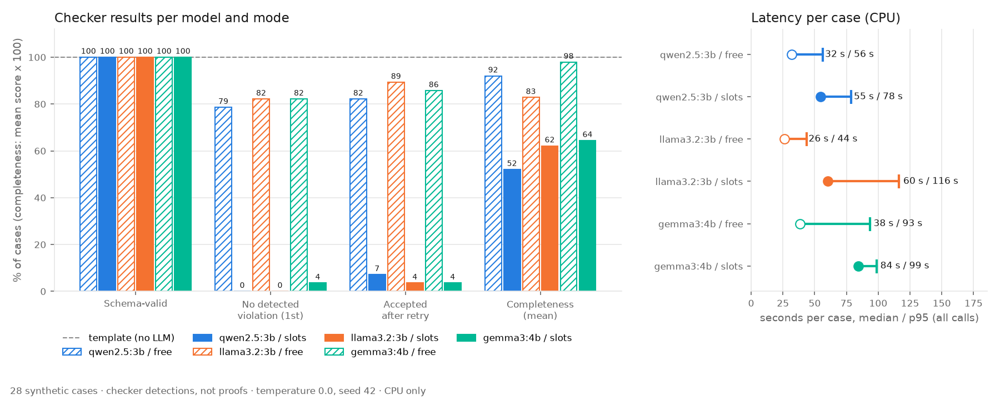

# Report drafts with a local LLM: results

BauLens drafts German inspection reports ("Prüfberichtsentwürfe") from the strength and crack
predictions with a small local language model. A numeric faithfulness gate stands between the
model and the reader: a draft is delivered only if the checker finds no violation in it;
otherwise the reader gets a deterministic template report, labelled as such. This page
describes the two generation modes, the checker, the metrics and the comparison of three
small models on CPU. The architecture decision is in [ADR 0004](../adr/0004-llm-pipeline.md).

> **What the numbers mean.** All rates are *checker detections on a fixed synthetic suite of
> 28 cases*: "no detected violation" means the checker found nothing, not that the draft is
> proven correct. With 28 cases per row, even a row with zero detections is compatible with a
> true violation rate of up to about 10 % (95 % upper bound, rule of three); the bound is
> illustrative because the cases are synthetic and not a random sample of real reports.

## Two generation modes

| Mode | Who writes the numbers | What is enforced |
| --- | --- | --- |
| `slots` (production default, with template fallback) | Code. The model writes `{druckfestigkeit}`; code inserts `61,9 MPa`, with sign and unit. | Strict slot rules (below): no numeral of any kind outside slots, no sign or unit next to a slot, exact slot grammar, role, feature and context rules per slot, mandatory facts. |
| `free` (evaluated unconstrained baseline) | The model. | Every ASCII-digit number must be a fact in exactly its rendered form, with its unit, bound to its role by the words around it; every other numeral fails closed. |

**What "code-owned" means and what it does not.** In slot mode every digit, sign and unit that
reaches the reader comes from the input, rendered by code. What the model still controls is
*which* slot it puts *where*, and the prose around it. The slot rules check placement against
a fixed vocabulary per slot; they do not verify whether the surrounding prose is true or
sensible. Free-text checking is bounded by what a parser recognises, which is why slot mode is
the production path and free text the baseline.

## Setup

| | |
| --- | --- |
| Cases | 28 synthetic `InspectionInput` cases in [`data/report_cases/cases.jsonl`](../../data/report_cases/cases.jsonl), generated by `baulens report make-cases` (seed 20261126): 12 strength-only, 9 crack-only, 7 with both; crack and no crack; 5 probabilities within 0.03 of the threshold, also at tuned thresholds 0.42 and 0.61; 4 mixes outside the training range; ages 1, 2, 3, 7, 28, 56, 90, 365 and 730 days; one interval with a negative lower bound; narrow (about 9 MPa) to wide (about 31 MPa) intervals; element names with umlauts |
| Models | `qwen2.5:3b`, `llama3.2:3b`, `gemma3:4b` (Q4_K_M, Ollama 0.40.18), each in both modes, plus the template report as a baseline. `baulens report generate` defaults to `gemma3:4b` in slot mode |
| Decoding | Identical for all runs: temperature 0, seed 42, `num_predict` 1024, `num_ctx` 4096, JSON schema with the case's sections via Ollama structured outputs; one model in memory at a time (unloaded with `keep_alive` 0 before the next) |
| Prompts | [`report_v2.yaml`](../../src/baulens/report/prompts/report_v2.yaml) (free) and [`report_slots_v2.yaml`](../../src/baulens/report/prompts/report_slots_v2.yaml) (strict slots), facts rendered by [`facts.py`](../../src/baulens/report/facts.py) |
| Policy | One schema retry, one corrective retry listing the violations, otherwise rejected; only accepted drafts are delivered |
| Hardware | Windows 11, AMD Ryzen 7 5700U (8 cores, 16 threads), 15 GiB RAM, no GPU |

The cases are synthetic: mixes are drawn from the UCI ranges and strengths from an
Abrams-type water/binder relation with an age factor, so they look like real model outputs.
They test the report generator, not the strength or crack models.

## Metrics

| Metric | Definition |
| --- | --- |
| Schema-valid (1st try / final) | Share of cases whose first reply, or any reply, validates against the draft schema (after slot rendering) |
| No detected violation, first draft | Share of cases whose first schema-valid draft has no detected violation (no valid draft counts as a failure) |
| Accepted after retry | Share of cases whose delivered report is the model's own draft (status `accepted`) |
| Rejected / invalid / error / replay miss | Cases with violations after the corrective retry / without a schema-valid draft / with a service error / without a complete recorded path. Replay misses, before the first call or after some recorded calls, are excluded from every rate, mean and latency; the template row is credited only in its own explicit baseline run |
| Violations per first draft | Mean number of `invented`, `misattributed`, `inexact`, `unbound` and `missing` findings in the first schema-valid draft |
| Completeness | Mean share of required items over schema-valid drafts (accepted and rejected) / over accepted drafts |
| Latency | Wall-clock time per case over all completed calls (median and 95th percentile); failed calls are counted separately |
| Tokens/s | Sum of Ollama's `eval_count` divided by the sum of `eval_duration` (generation only) |
| Ollama model size | `size` reported by `/api/ps` for the loaded model (weights, KV cache and buffers) |
| Peak runner RSS | Largest resident set of an Ollama process, including its `llama-server` runner (psutil) |
| System CPU | Mean and maximum system-wide CPU utilisation sampled every second during the run |
| Labelled-sentence errors | Correct sentences the checker flags (false positives) and wrong sentences it passes (false negatives) on the hand-labelled set [`labelled_sentences.yaml`](../../data/report_cases/labelled_sentences.yaml) |

**Completeness items.** Strength cases: point value, both interval bounds, coverage and age
stated; the estimate called a model estimate; a reference to testing; an out-of-domain warning
when `in_training_domain` is false, and no unconditional out-of-domain claim when it is true.
Crack cases: probability and threshold stated; an *explicit* crack finding consistent with the
label; the patch-level limitation; a recommendation of visual inspection on site. Every
report: the code-inserted disclaimer. In slot mode the point estimate, both bounds and the
crack finding are not only scored but required for delivery (`missing`).

## Results

<!-- compare:begin -->
_Generated by `baulens report compare` on 2026-11-27: 28 cases, prompts free `report-v2+7293be1d`, slots `report-slots-v2+2cb75cd4`, checker v4, Ollama 0.40.18, Windows 11, AMD64 Family 23 Model 104 Stepping 1, AuthenticAMD, 16 logical CPUs, 15 GiB RAM, system CPU load 1 % before this invocation; results of qwen2.5:3b / free, qwen2.5:3b / slots, llama3.2:3b / free, llama3.2:3b / slots, gemma3:4b / free, gemma3:4b / slots come from earlier invocations into the same run directory and were reused after manifest validation (inputs, prompts, checker, options); resource columns were measured during those invocations._

| Model / mode | Cases | Schema-valid (1st try / final) | No detected violation, first draft | Accepted after retry | Rejected / invalid / error / replay miss | Violations per first draft (invented / misattributed / inexact / unbound / missing) | Completeness (drafts / accepted) |
| --- | ---: | ---: | ---: | ---: | ---: | ---: | ---: |
| qwen2.5:3b / free | 28 | 100 % / 100 % | 79 % | 82 % | 5 / 0 / 0 / 0 | 0.11 / 0.29 / 0.00 / 0.04 / 0.00 | 0.92 / 0.93 |
| qwen2.5:3b / slots | 28 | 100 % / 100 % | 0 % | 7 % | 26 / 0 / 0 / 0 | 6.89 / 3.07 / 0.00 / 0.00 / 1.32 | 0.52 / 0.75 |
| llama3.2:3b / free | 28 | 100 % / 100 % | 82 % | 89 % | 3 / 0 / 0 / 0 | 0.00 / 0.11 / 0.00 / 0.21 / 0.00 | 0.83 / 0.82 |
| llama3.2:3b / slots | 28 | 100 % / 100 % | 0 % | 4 % | 27 / 0 / 0 / 0 | 2.79 / 4.93 / 0.00 / 0.75 / 1.00 | 0.62 / 0.50 |
| gemma3:4b / free | 28 | 100 % / 100 % | 82 % | 86 % | 4 / 0 / 0 / 0 | 0.07 / 0.18 / 0.00 / 0.07 / 0.00 | 0.98 / 0.98 |
| gemma3:4b / slots | 28 | 100 % / 100 % | 4 % | 4 % | 27 / 0 / 0 / 0 | 0.57 / 5.43 / 0.00 / 0.07 / 1.68 | 0.64 / 1.00 |
| template (no LLM) | 28 | 100 % / 100 % | 100 % | 100 % | 0 / 0 / 0 / 0 | 0.00 / 0.00 / 0.00 / 0.00 / 0.00 | 1.00 / 1.00 |

| Model / mode | Latency per case, median / p95 (s) | Calls per case | Output tokens per call | Tokens/s | Load time (s) | Ollama model size (GiB) | Peak runner RSS (GiB) | System CPU mean / max |
| --- | ---: | ---: | ---: | ---: | ---: | ---: | ---: | ---: |
| qwen2.5:3b / free | 31.8 / 56.4 | 1.21 | 344 | 15.8 | 6.5 | 2.02 | 3.37 | 58 % / 86 % |
| qwen2.5:3b / slots | 54.6 / 78.5 | 2.00 | 319 | 15.6 | 6.5 | 2.02 | 5.33 | 56 % / 84 % |
| llama3.2:3b / free | 26.3 / 43.9 | 1.18 | 268 | 15.2 | 6.0 | 2.39 | 5.66 | 56 % / 70 % |
| llama3.2:3b / slots | 60.4 / 116.2 | 2.00 | 319 | 12.1 | 6.0 | 2.39 | 8.12 | 67 % / 100 % |
| gemma3:4b / free | 38.5 / 93.5 | 1.18 | 315 | 10.5 | 8.9 | 2.69 | 9.14 | 71 % / 100 % |
| gemma3:4b / slots | 84.4 / 98.7 | 1.96 | 381 | 12.1 | 8.9 | 2.69 | 9.01 | 59 % / 94 % |
| template (no LLM) | 0.002 / 0.005 | 0.00 | - | - | - | - | - | - |

Checker on the hand-labelled sentences of [`labelled_sentences.yaml`](../../data/report_cases/labelled_sentences.yaml):

| Mode | Correct sentences flagged (false positives) | Wrong sentences passed (false negatives) |
| --- | ---: | ---: |
| free | 6 / 14 | 1 / 9 |
| slots | 0 / 9 | 0 / 10 |
<!-- compare:end -->



### Discussion

**The gate holds; what gets delivered is the question.** Every delivered model report passed the
checker, and every other case went out as the labelled template report. No run had an invalid
reply, a service error or a replay miss.

**Strict slots: the small models do not follow the contract.** All three models accepted only
1 or 2 of 28 slot drafts (4–7 %). The dominant reason is a unit or sign written next to a slot
("{druckfestigkeit} MPa", "{ueberdeckung} %"). It appears in 27 of 27 rejected gemma3 drafts, 26
of 26 qwen2.5 drafts and 13 of 27 llama3.2 drafts, and the corrective prompt rarely removes it.
In about half of the rejected gemma3 and qwen2.5 drafts it is the *only* rule broken. Those
slots then also count as unused, so the mandatory-fact check adds `missing`. Literal numbers
outside slots (case IDs copied as text, invented counts) and slots in the wrong clause come next.
On this suite and with models of this size, strict slot mode therefore delivers the template
report in practice. That is safe, but it is not what slot mode is for.

**Free text accepts more, and the gate catches real errors.** 79–82 % of first drafts had no
detected violation and 82–89 % were accepted after at most one correction. Detected errors
include qwen2.5 inventing a complete strength result (100 MPa, interval 90–110 MPa, "2 Jahre")
for a crack-only case, signs dropped from contributions, and JSON fragments without units.
Some rejections are known fail-closed false positives, for example element names quoted in part
("Achse 4", "Feld C2"), which are no longer masked.

**Labelled sentences.** On the hand-labelled set, slot mode flags none of the 9 correct
sentences and passes none of the 10 wrong ones. Free text flags 6 of 14 correct sentences
(elliptical and list-style phrasing, unsigned contributions, number words, the verb "achten")
and passes 1 of 9 wrong ones (a negation). The set is small and written by the author, so these
are indications, not rates.

**Recommendation.** Keep slot mode with template fallback as the production path: it is the
only mode whose delivered numbers do not depend on parser coverage. To make it *useful* with
small local models, the next step is one of the following:
- a documented, deterministic normalisation that removes a unit identical to the slot's own
  unit before checking;
- constrained decoding that cannot emit a unit after a slot;
- a larger model.

None of these is part of this PR. For the public demo, replay mode with `gemma3:4b` shows mostly
template reports with honest provenance labels. Free text with `gemma3:4b` (86 % accepted,
completeness 0.98) is the best *evaluated* model output, under the free-text limits listed below.

**Speed.** Measured while the machine was otherwise idle (1–11 % CPU before each invocation;
56–71 % mean during generation, which is Ollama itself). A free-text report took a median of
26–39 s and a slot report 55–84 s (about two calls per case). Generation ran at 10–16 tokens/s.

## Strict slot mode (checker v4)

Implemented in [`slots.py`](../../src/baulens/report/slots.py); every rule has regression
tests in [`tests/test_report_slots.py`](../../tests/test_report_slots.py).

1. **Grammar.** A slot is exactly `{name}` with a lowercase name from the case's list. Markdown
   emphasis directly around a slot (`**{x}**`, `*{x}*`, `__{x}__`) is stripped before checking
   and is not delivered. Any other brace or backslash (`{X}`, `{x:y}`, `{{x}}`, `\{x}`) and any
   unknown name is `invented`.
2. **Code owns the quantity.** Slots render sign, value and unit. A sign before a slot, or a
   unit, `%`, "Prozent", "-Punkte" or "Uhr" after it, is a violation.
3. **No numerals outside slots.** The shared numeral detector
   ([`numerals.py`](../../src/baulens/report/numerals.py)) flags any numeric Unicode character
   (any script's digits, superscripts, circled and enclosed numbers, Roman numeral characters,
   vulgar fractions), Roman numerals written with letters, and German number words in any
   capitalisation: cardinals, ordinals ("erste", "achtundzwanzigste"), fractions ("halb",
   "Drittel"), multipliers ("doppelt", "dreifach", "zweimal") and quantity nouns ("Dutzend",
   "Paar", "Hunderte"). The articles "ein/eine/…", lowercase "paar" (a few), "einmal",
   "mehrfach" and "beide" are allowed. Case id, element, file, model names and the two citable
   standards are slots too, so nothing is masked; a strength class inside an element name can
   only appear through `{bauteil}`.
4. **Role binding.** A numeric slot's clause must not name a different quantity of the same unit
   ("Die Druckfestigkeit beträgt {obere_grenze}" → `misattributed`); if it names none, the
   sentence must contain the slot's own vocabulary. Ingredient and contribution slots are
   field-specific (`{beitrag_zement}`, `{beitrag_betonalter}`) and must be in a clause that
   names their own ingredient or feature. "von {untere_grenze} bis {obere_grenze}" binds the
   bounds by order; reversed bounds are caught.
5. **Forbidden contexts.** Deadline vocabulary ("Frist", "Termin", "Deadline", "spätestens", …)
   in the sentence, or a negation ("nicht", "kein …" except "kein Riss") in the clause, is a
   violation. Capture date and time need a capture context ("aufgenommen").
6. **Mandatory facts.** A strength draft must use the point estimate and both bounds; a crack
   draft must state the finding explicitly and consistently with the label.
7. **Post-render validation.** If rendering pushes a section over its length limit, the draft
   goes through the schema retry and then the labelled fallback; it never raises.

## Free-text checker (baseline)

[`numbers.py`](../../src/baulens/report/numbers.py) extracts ASCII-digit numbers and
[`faithfulness.py`](../../src/baulens/report/faithfulness.py) judges them; every other numeral
comes from the shared detector and is `invented`.

- **One rendering per fact, no rounding freedom.** Every fact is rendered once, German format,
  ROUND_HALF_UP. The crack probability gets as many decimals as needed, without a cap, for the
  rendered comparison to equal the raw one; the threshold is shown exactly (0.4999999999
  against 0.5 renders as `49,99999999 %` against `50 %`, also in the template). Only the same
  digits and sign are accepted; `−`/`-` and `1040`/`1.040`/`1 040` are the only equivalences.
- **One locale.** `1,040` is 1,04; `61.9` is a foreign format (`inexact`).
- **Units.** The unit right after a number must be the fact's unit; missing, unknown (`t/m³`,
  `kg`, `Jahre`) or "%-Punkte" is `misattributed`.
- **Roles.** The words before the number (back to the previous number or a clause boundary),
  then those after it or in a following parenthesis, then the earlier part of the clause must
  name the fact's role. Ranges bind bounds by position. Days need "Alter"; contributions need
  their own feature in the clause; deadline vocabulary is a violation; the capture date and
  time need a capture context. Unnamed roles are `unbound` (fail closed).
- **Identifiers.** Only complete input strings are masked, as whole tokens; identifiers that
  look like numbers only after a label ("Fall 123456"). Parts of an element name are never
  masked. There is no exemption for list markers ("9." is a number).

## Labelled sentences: false positives and false negatives

The checker's own error rates on hand-written sentences for PB-022 (both results), in
[`labelled_sentences.yaml`](../../data/report_cases/labelled_sentences.yaml). The table is
regenerated by `baulens report compare` (see the end of the generated results block above).

| Mode | Correct sentences flagged (false positives) | Wrong sentences passed (false negatives) |
| --- | ---: | ---: |
| free | 6 / 14 | 1 / 9 |
| slots | 0 / 9 | 0 / 10 |

The free-text false positives are deliberate fail-closed behaviour on phrasing whose role or
sign the parser cannot establish. They include the two elliptical constructions observed in
earlier runs, unsigned contributions, number words and the verb "achten", which the detector
reads as an ordinal. The free-text false negative is a negation ("beträgt nicht 37,9 MPa"),
which only slot mode rejects.

## Limitations

- **Semantics are not verified.** Neither mode checks whether the prose is true: a draft can
  bind every number correctly and still recommend something unsuitable or misjudge a
  borderline probability. In slot mode the vocabulary rules narrow where a quantity may be
  placed, not what is claimed about it. The code-inserted disclaimer and an engineer's
  review remain necessary.
- **Free text is a baseline, not a guarantee.** It fails closed on unusual phrasing (see the
  false positives above) and misses claims that change a number's meaning without a numeral,
  most notably negation ("beträgt nicht 37,9 MPa"), which only slot mode rejects.
- **Vocabularies are finite.** The role, deadline, negation and capture lists are short and
  German; a synonym outside them fails closed in slot mode (`unbound`) and may pass or fail in
  free text.
- **Number-like words outside the list** (see the numeral detector above) and numbers inside
  identifiers that the model copies verbatim through their slot are out of scope.

## Examples

All examples come from the recorded checker-v4 run and can be reproduced offline with
`baulens report generate --mode replay --model <model> --generation <mode> --input <case>.json`.

**1. An accepted strict slot draft (gemma3:4b, PB-017, crack only, no crack).** Model output
(excerpt):

> Die Risswahrscheinlichkeit beträgt `{risswahrscheinlichkeit}` und die Entscheidungsschwelle
> liegt bei `{entscheidungsschwelle}`. Das Ergebnis der Klassifikation lautet: kein Riss
> erkannt. Die Analyse wurde mit dem Rissmodell `{rissmodell}` durchgeführt …

Delivered: "Die Risswahrscheinlichkeit beträgt 9,6 % und die Entscheidungsschwelle liegt bei
61 %. … kein Riss erkannt. … mit dem Rissmodell resnet18 (Version m3-preview) …". Every digit
and unit was inserted by code.

**2. The typical slot rejection (gemma3:4b, PB-001).** The first draft and its correction were
identical:

> Die prognostizierte Druckfestigkeit beträgt `{druckfestigkeit}` MPa. Das Prognoseintervall
> erstreckt sich von `{untere_grenze}` MPa bis `{obere_grenze}` MPa.

```text
misattributed  {druckfestigkeit}  Vorzeichen oder Einheit neben dem Platzhalter; der Platzhalter enthält sie
missing        {druckfestigkeit}  Pflichtangabe fehlt
```

Rendering would have produced "61,9 MPa MPa". The case was delivered as the template report.

**3. A caught hallucination (qwen2.5:3b, free text, PB-015, crack only).**

> Die prognostizierte Druckfestigkeit beträgt **100 MPa**, die untere Grenze des
> Prognoseintervalls liegt bei **90 MPa**, die obere Grenze … **110 MPa**, die nominelle
> Überdeckung beträgt **95 %**, und das Betonalter beträgt **2 Jahre**.

All five numbers are `invented`: the case has no strength result at all. The report was
rejected and the template delivered.

**4. Correct numbers, wrong claim (llama3.2:3b, slots, PB-019, below the threshold).**
Accepted after one correction:

> Die Risswahrscheinlichkeit beträgt 48,2 % der untere Grenze, die Entscheidungsschwelle wurde
> überschritten und das Ergebnis ist ein 'kein Riss erkannt'.

The probability is correct, inserted by code and named by "Risswahrscheinlichkeit". But the
threshold was *not* exceeded, and "der untere Grenze" is nonsense. Neither rule set verifies
such claims. This is what the code-inserted disclaimer and an engineer's review are for.

## Run notes

- Run directory `artifacts/report/runs/v4` (2026-11-27, checker v4, prompts `report-v2` and
  `report-slots-v2`). It was produced by one `compare --resume … --model <m>` invocation per
  model, each followed by a commit of that model's replies, and an assembly invocation that
  reused all six (model, mode) runs after validating their manifests (model, mode, source,
  prompts, checker, options, input digests). The machine was otherwise idle; one model was in
  memory at a time.
- Earlier runs with checker v1–v3 (2026-11-26) are superseded by the two reviews of PR #11
  and are not reported. Their lessons are in the checker rules above.
- "Load time" is the wall time of the load request. "Peak runner RSS" includes Ollama's
  `llama-server` runner; it is larger than the `/api/ps` size, presumably because it also counts
  runtime buffers and, for gemma3, the vision projector.
- Re-run with `uv run baulens report compare`. It re-records the replies in
  `data/report_replays/`, rewrites the tables above and the figure, and recomputes the
  labelled-sentence table.

## Model licences

The repository does not redistribute model weights; Ollama downloads them. Two questions are
kept apart: whether *using* the model here is allowed, and what the terms say about *outputs*
such as the replay files.

| Model | Model use | Outputs (replay files) |
| --- | --- | --- |
| Qwen2.5 3B Instruct ([Qwen Research License](https://huggingface.co/Qwen/Qwen2.5-3B-Instruct/raw/main/LICENSE)) | §2(a) grants use of the Materials for non-commercial purposes only, which §1(i) defines as research or evaluation; commercial use needs a separate licence (§2(b)). This comparison is an evaluation | §4(b) requires "Built with Qwen" or "Improved using Qwen" in the product documentation when outputs are used to create, train, fine-tune or improve a distributed AI model; we do not do that. We found no clause restricting the publication of outputs as such and make no broader claim |
| Llama 3.2 3B Instruct ([Llama 3.2 Community License](https://raw.githubusercontent.com/meta-llama/llama-models/main/models/llama3_2/LICENSE), [Acceptable Use Policy](https://github.com/meta-llama/llama-models/blob/main/models/llama3_2/USE_POLICY.md)) | Use is governed by the licence and the Acceptable Use Policy | "Built with Llama" applies when Llama Materials, their derivatives or a product containing them are made available; we found no express clause covering static synthetic outputs and credit Llama 3.2 here anyway |
| Gemma 3 4B ([Gemma Terms of Use](https://gemma.ai/resources/terms/), [Prohibited Use Policy](https://gemma.ai/resources/prohibited-use/)) | Use is subject to the terms and the Prohibited Use Policy | The terms exclude Outputs from Model Derivatives, and Google claims no rights in outputs |

This is a reading of the primary terms for a portfolio project, not legal advice.

## Reproduce

```sh
uv run baulens report compare                             # all models, both modes; rewrites docs and replays
uv run baulens report compare --model gemma3:4b           # one model
uv run baulens report compare --resume artifacts/report/runs/<dir>   # reuse identical finished runs
uv run baulens report compare --source replay --model gemma3:4b --no-replays --no-docs   # offline re-score
uv run baulens report generate --input case.json                     # gemma3:4b, slot mode, live
uv run baulens report generate --input case.json --mode replay
uv run baulens report generate --input case.json --generation free --model qwen2.5:3b
uv run baulens report check --input case.json --text draft.txt --all
```

Raw per-case results (drafts, raw slot drafts, every check with its verdict, attempts, timing
counters) are written to `artifacts/report/runs/<dir>/`, with one manifest per model and mode
(model, mode, source, prompt, checker version, options, input digests) that `--resume` checks
before reusing anything.
