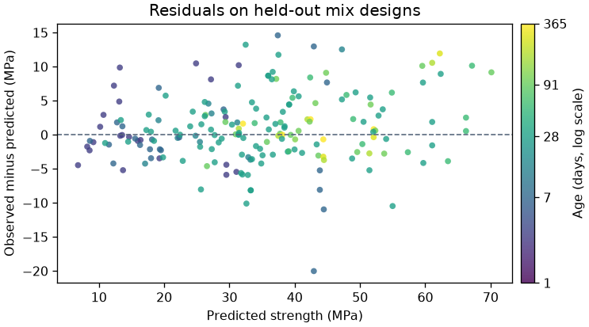
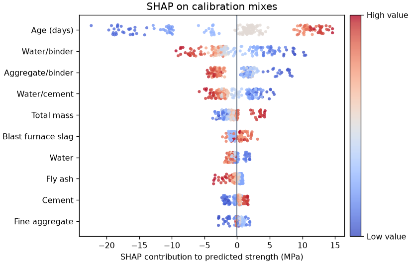
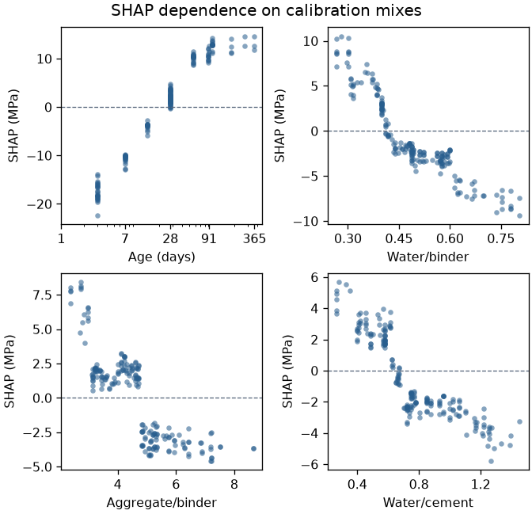

# Concrete compressive strength

**Histogram GBM (raw + engineered)** (`9a6c8beadf10`) achieved **3.83 MPa MAE** on 86 unseen mix designs. The 90% prediction intervals covered 95.7% of measurements and 93.0% of entire mixes.

## Data and protocol

This run read 1030 measurements from the [UCI concrete strength data](https://doi.org/10.24432/C5PK67). It removed 25 exact duplicate rows and kept distinct outcomes at the same mix and age. A mix is the exact tuple of its seven ingredients in kg/m³. The test split used 5 strata of mean strength per mix. Calibration mixes were randomly drawn from the remainder.

| Partition | Rows | Mixes |
| --- | ---: | ---: |
| Fit | 616 | 256 |
| Calibration | 201 | 86 |
| Test | 188 | 86 |

All candidates used the same repeated shuffled GroupKFold outer splits. Tuned hyperparameters and final refit settings came from grouped inner CV, scored by MAE. Selection used the lowest mean grouped outer MAE. The fitting partition includes the outer validation folds and supplies the final refit. The refit then predicts the separate calibration partition for interval construction. See the [evaluation ADR](../adr/0003-strength-evaluation-protocol.md).

## Engineered features

Binder is cement plus blast-furnace slag and fly ash. SCM is slag plus fly ash.

| Feature | Rationale |
| --- | --- |
| `water_cement` | Abrams' law relates water per unit of cement to strength through porosity. |
| `water_binder` | Water per unit of binder accounts for slag and fly ash in blended mixes. |
| `log_age` | Log age represents the slowing rate of strength gain as hydration progresses. |
| `scm_fraction` | Slag and fly ash track changes to hydraulic and pozzolanic reactions. |
| `superplasticizer_binder` | Binder-normalised dosage relates to dispersion and water demand. |
| `coarse_fine_aggregate` | Coarse-to-fine balance can affect particle packing and water demand. |
| `aggregate_binder` | Aggregate relative to binder tracks the balance of skeleton and paste. |
| `total_mass` | Summed mass per cubic metre is a proxy for mixture density. |

## Repeated cross-validation and feature ablation

Cells show fold mean ± sample SD and a 95% Student t interval in brackets. Intervals use repeat means as the observations because folds share training rows. Repeats share the same underlying mixes. The full run uses three repeats. The intervals describe split sensitivity and offer limited evidence about differences between candidates. The single-repeat smoke run omits them.

| Family | Inputs | MAE (MPa) | RMSE (MPa) | R² |
| --- | --- | ---: | ---: | ---: |
| Mean | Raw | 13.37 ± 1.35 [13.31, 13.43] | 16.75 ± 1.56 [16.64, 16.85] | -0.02 ± 0.04 [-0.06, 0.02] |
| Mean | Raw + engineered | 13.37 ± 1.35 [13.31, 13.43] | 16.75 ± 1.56 [16.64, 16.85] | -0.02 ± 0.04 [-0.06, 0.02] |
| Linear | Raw | 8.35 ± 0.91 [8.00, 8.71] | 10.72 ± 1.10 [10.22, 11.22] | 0.57 ± 0.09 [0.53, 0.62] |
| Linear | Raw + engineered | 5.65 ± 0.73 [5.35, 5.95] | 7.26 ± 0.86 [6.96, 7.56] | 0.81 ± 0.04 [0.79, 0.82] |
| Ridge | Raw | 8.36 ± 0.91 [7.99, 8.72] | 10.73 ± 1.10 [10.22, 11.24] | 0.57 ± 0.09 [0.53, 0.62] |
| Ridge | Raw + engineered | 5.63 ± 0.79 [5.31, 5.94] | 7.26 ± 0.90 [6.91, 7.60] | 0.81 ± 0.04 [0.79, 0.82] |
| Random forest | Raw | 5.04 ± 0.77 [4.77, 5.32] | 6.93 ± 1.03 [6.47, 7.40] | 0.82 ± 0.05 [0.81, 0.84] |
| Random forest | Raw + engineered | 4.44 ± 0.64 [4.27, 4.61] | 6.21 ± 0.90 [5.93, 6.50] | 0.86 ± 0.04 [0.85, 0.87] |
| Histogram GBM | Raw | 5.04 ± 0.65 [4.74, 5.33] | 6.98 ± 0.88 [6.50, 7.47] | 0.82 ± 0.05 [0.79, 0.84] |
| Histogram GBM | Raw + engineered | 4.30 ± 0.64 [4.04, 4.56] | 6.10 ± 1.03 [5.51, 6.70] | 0.86 ± 0.06 [0.83, 0.88] |
| LightGBM | Raw | 5.05 ± 0.68 [4.85, 5.26] | 7.05 ± 0.91 [6.75, 7.36] | 0.81 ± 0.06 [0.80, 0.83] |
| LightGBM | Raw + engineered | 4.42 ± 0.80 [4.03, 4.82] | 6.36 ± 1.15 [5.51, 7.20] | 0.85 ± 0.06 [0.81, 0.88] |

Engineered minus raw MAE (MPa, lower is better) for each family.

| Mean | Linear | Ridge | Random forest | Histogram GBM | LightGBM |
| ---: | ---: | ---: | ---: | ---: | ---: |
| +0.00 | -2.71 | -2.73 | -0.60 | -0.73 | -0.63 |

### What a shuffled row split would report

The comparison uses the selected family and feature set, the same development rows, fold counts, seeds and tuning grid, and row splits at both CV levels.

| Protocol | MAE (MPa) | RMSE (MPa) | R² |
| --- | ---: | ---: | ---: |
| Grouped | 4.30 ± 0.64 [4.04, 4.56] | 6.10 ± 1.03 [5.51, 6.70] | 0.86 ± 0.06 [0.83, 0.88] |
| Random row | 3.22 ± 0.34 [3.03, 3.40] | 4.84 ± 0.70 [4.57, 5.11] | 0.91 ± 0.02 [0.90, 0.93] |

In random-row CV, 74.9% of validation rows shared their mix design with a fitting row. Grouped minus random-row MAE was +1.09 MPa. The grouped score estimates error for an unseen formulation.

## Held-out mix designs

95% percentile intervals use 2,000 bootstrap replicates. Each samples complete test mixes with replacement and weights all measurements equally. The bootstrap describes holdout uncertainty for the frozen fit.

| Metric | Estimate | 95% group bootstrap CI |
| --- | ---: | ---: |
| MAE (MPa) | 3.827 | [3.001, 4.682] |
| RMSE (MPa) | 5.166 | [4.056, 6.212] |
| R² | 0.895 | [0.864, 0.923] |



### Error and coverage by age

Split conformal uses one maximum absolute residual per calibration mix. The finite-sample order statistic gave a radius of 10.86 MPa. The same radius applies to each prediction. With exchangeable mixes, this construction targets joint coverage across the measured ages of a new mix. Strength stratification and source shift can affect exchangeability. Empirical bucket coverage can vary in small samples. Every measurement was covered in 93.0% of test mixes. Positive bias means the model underpredicted the observed strength.

| Age (days) | Rows | Mixes | MAE (MPa) | Bias (MPa) | Coverage | Mean width (MPa) |
| --- | ---: | ---: | ---: | ---: | ---: | ---: |
| Overall | 188 | 86 | 3.83 | +0.88 | 95.7% | 21.71 |
| 1-7 | 45 | 33 | 4.59 | +0.13 | 91.1% | 21.71 |
| 8-28 | 95 | 83 | 3.66 | +0.70 | 96.8% | 21.71 |
| 29-99 | 25 | 23 | 3.63 | +1.90 | 100.0% | 21.71 |
| 100+ | 23 | 15 | 3.23 | +1.98 | 95.7% | 21.71 |

The 1-7 day bucket had the highest MAE (4.59 MPa) across 33 mixes.

### Error by observed strength

| Strength (MPa) | Rows | Mixes | MAE (MPa) | Bias (MPa) |
| --- | ---: | ---: | ---: | ---: |
| <20 | 37 | 30 | 2.30 | -1.08 |
| 20 to <40 | 85 | 55 | 3.25 | -0.52 |
| 40 to <60 | 55 | 35 | 5.06 | +3.10 |
| 60+ | 11 | 4 | 7.24 | +7.24 |

Error was highest in the 60+ MPa range (7.24 MPa MAE). Its mean observed-minus-predicted residual was +7.24 MPa across 4 mixes.

### Worst-predicted mixes

Ranked by largest absolute residual at any recorded age. The table shows the worst measurement per mix. Mix IDs identify the exact tuple in `test_predictions.csv`.

| Mix ID | Rows | Age (days) | Water/cement | Observed (MPa) | Predicted (MPa) | Residual (MPa) |
| ---: | ---: | ---: | ---: | ---: | ---: | ---: |
| 356 | 6 | 7 | 0.45 | 22.90 | 42.93 | -20.03 |
| 398 | 4 | 7 | 0.36 | 52.01 | 37.41 | +14.60 |
| 162 | 5 | 28 | 0.85 | 45.71 | 32.49 | +13.22 |
| 427 | 7 | 14 | 0.32 | 59.76 | 47.23 | +12.53 |
| 150 | 1 | 28 | 0.95 | 49.25 | 37.51 | +11.74 |

## Explainability

SHAP values use the refitted model on calibration mixes. The summary ranks features by mean absolute contribution. Dependence plots show fitted associations in MPa.





The strongest attribution on calibration mixes was `age_days` (7.62 MPa mean absolute SHAP).

Hydration generally raises strength with age. Higher water ratios generally reduce strength at similar composition and curing. `age_days` agrees with the expected direction (+0.96). `water_cement` agrees with the expected direction (-0.90). `water_binder` agrees with the expected direction (-0.95). These are rank correlations between feature values and their own attributions. The model can share attribution among correlated raw and engineered inputs. The plots describe associations within this dataset and cannot establish causal effects.

Permutation importance measures the mean increase in MAE on the grouped validation folds for the chosen pipeline. Each shuffle permutes a raw column before recomputing derived ratios. Shuffles can create uncommon ingredient combinations.

| Raw input | Increase in MAE (MPa) |
| --- | ---: |
| `cement` | +10.26 |
| `age_days` | +7.87 |
| `blast_furnace_slag` | +5.43 |
| `fly_ash` | +2.39 |
| `water` | +1.34 |
| `fine_aggregate` | +0.94 |
| `coarse_aggregate` | +0.83 |
| `superplasticizer` | +0.28 |

## Limitations and reproduction

This small historical benchmark is based on formulations published by Yeh in 1998. The workbook omits lab and batch identifiers, cement type, and curing conditions. Grouping detects exact formulations. Rounded variants or related production batches may still span partitions. A new lab, material source, or curing regime may change accuracy and coverage. Input ranges detect marginal extrapolation. In-range ingredients can still form an unfamiliar mix. The [model card](../model_cards/strength.md) describes intended use.

```sh
uv run --locked baulens strength train --config configs/strength.yaml
uv run --locked baulens strength evaluate --config configs/strength.yaml
```

Training took 177.2 s on a CPU under shared load. The local `artifacts/strength/` directory contains every fold score, test prediction, and a machine-readable copy of the metrics. Evaluation reuses cached predictions for the identical fitted model.
